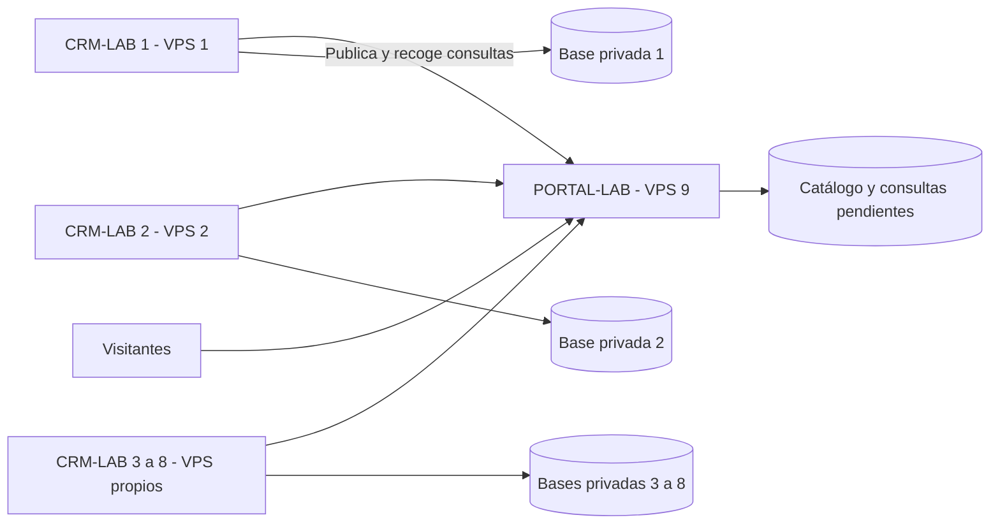

# Arquitectura de productos independientes

## Topología

Ocho CRM-LAB, uno por inmobiliaria y VPS nuevo. Un noveno VPS ejecuta PORTAL-LAB. VPS separado significa máquina virtual independiente, no hardware físico dedicado.

Las flechas indican quién inicia HTTPS; las respuestas devuelven también las consultas. El portal no se conecta a las bases privadas.

## Propiedad de datos

| Información | Fuente principal | Copia autorizada |
| --- | --- | --- |
| Propiedad e historial | Su CRM | Ninguna copia completa en portal |
| Oferta de venta o alquiler | Su CRM | Ficha pública en portal |
| Propietario y negociación | Su CRM | No se envían |
| Originales de fotos | Su CRM | Derivados públicos en portal |
| Consulta de visitante | Portal hasta entrega | CRM destino para seguimiento |
| Contacto y oportunidad | Su CRM | Solo datos temporales de entrega en portal |
| Permiso de publicar | CRM; portal puede suspender | Portal no edita inventario privado |

Clave de publicación: `(agency_id, source_listing_id)`. Una publicación representa una oferta: un inmueble en venta y alquiler puede tener dos. Dos inmobiliarias pueden ofrecer el mismo inmueble sin fusionar información ni contactos.

## Aislamiento

Cada CRM tiene base, usuarios, archivos, secretos y backups separados. No necesita selector de tenant en el MVP; sí roles y permisos de agente, gerente, editor y sucursal.

El portal es multicliente en la integración: cada credencial solo accede a sus fichas, medios y consultas. Filtrar por conexión autenticada y reforzar con RLS de PostgreSQL. El catálogo utiliza una proyección pública de campos. Las tablas de consultas y administración permanecen privadas.

Sesiones CRM y portal son independientes. El operador del portal no recibe acceso automático a los ocho CRM. Soporte y administración de servidores requieren acceso individual trazable.

## Catálogo local en el portal

Consultar ocho CRM por cada búsqueda acoplaría la latencia y disponibilidad del portal a todos ellos. La copia pública permite índices y SEO propios. Se acepta consistencia eventual: objetivo inicial de actualización menor a dos minutos en condiciones normales, por medir.

El CRM muestra pendiente, sincronizado o error. Un guardado local no confirma la publicación remota. Las fotos públicas también se copian: no se cargan desde un CRM posiblemente caído.

## Fallas y vigencia

| Falla | Respuesta prevista |
| --- | --- |
| Portal caído | CRM operativo, envíos en cola |
| CRM desconectado | Catálogo vigente visible; consultas esperan |
| Evento inválido de una agencia | Se aísla ese trabajo |
| Confirmación de consulta perdida | Reentrega y deduplicación en CRM |
| Publicación antigua llega tarde | Revisión impide sobrescribir la nueva |
| Credencial revocada | Se suspende esa conexión |
| Restauración de copia antigua | Reconciliar antes de reanudar envíos |

Propuesta de vigencia: ocultar fichas tras 72 horas sin reconciliación exitosa; avisar a los 15 minutos y a las 24 horas. Las bajas confirmadas son inmediatas. El operador del portal puede retirar una ficha urgente mientras un CRM está caído. Una señal de vida sin comprobar publicaciones no renueva su vigencia.

Cada VPS es un punto único de falla de su función. No se ofrece alta disponibilidad en el MVP. Compartir proveedor o región mantiene riesgos comunes; las copias externas y la restauración son obligatorias antes de datos reales.
