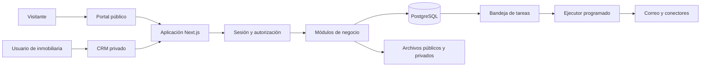

> HISTÓRICO — Diseño v1 sustituido el 9 de octubre de 2026. Consultar el README de la raíz para la arquitectura vigente de ocho CRM independientes y un portal.

# Arquitectura multicliente y modelo de datos

## Una aplicación con dos superficies

El CRM privado y el portal público comparten el inventario, pero presentan datos distintos. Se propone una aplicación Next.js con módulos internos para identidad, organizaciones, propiedades, publicaciones, contactos, oportunidades y actividades. Los servicios de negocio se reutilizan desde páginas y endpoints.

El gráfico representa componentes lógicos. En un VPS, web y ejecutor pueden ser procesos del mismo repositorio; PostgreSQL puede residir en ese servidor o en un servicio administrado. En Node.js administrado, el ejecutor depende de un mecanismo programado que debe verificarse durante la prueba técnica.

## Qué significa multicliente

Una inmobiliaria equivale a un `tenant`, es decir, una organización aislada. Una sucursal pertenece a una inmobiliaria. Un usuario puede ser miembro de más de una inmobiliaria, pero cada operación privada se ejecuta dentro de una membresía y un contexto activo verificados en el servidor.

Los compradores, propietarios e interesados son contactos comerciales; no son tenants. Los colaboradores de GitHub tampoco son automáticamente usuarios del CRM. Son tres tipos de identidad distintos.

Se propone una base compartida con `tenant_id` en todas las tablas de negocio. Facilita operar el piloto. Una base por inmobiliaria ofrece una frontera más fuerte y restauraciones independientes, pero aumenta migraciones, conexiones y operación. Se reserva como evolución para clientes que requieran aislamiento físico o contractualmente específico.

## Roles propuestos

| Rol | Alcance |
| --- | --- |
| Operador de plataforma | Alta y suspensión de organizaciones; no acceso ordinario a contactos privados |
| Administrador de inmobiliaria | Usuarios, configuración, inventario y gestión de su organización |
| Gerente | Equipo, asignación y reportes dentro de sus sucursales autorizadas |
| Agente | Propiedades y oportunidades según asignación; sin administración de usuarios |
| Editor | Preparación y publicación de fichas autorizadas, sin exportación general de contactos |
| Visitante | Lectura del catálogo publicado y envío de consultas |

Una eventual sesión de soporte requiere autorización temporal y auditoría. El rol técnico que aplica migraciones no debe ser el que usa la aplicación para atender solicitudes.

## Reglas de aislamiento

1. Resolver el usuario desde una sesión validada; comprobar membresía vigente y organización habilitada en cada acción privada.
2. No confiar en un `tenant_id` enviado por el navegador. Si una ruta lo contiene, contrastarlo con la membresía antes de usarlo.
3. Filtrar las consultas de negocio por tenant y aplicar políticas RLS en PostgreSQL como segunda barrera.
4. Usar un rol de ejecución sin privilegio `BYPASSRLS`, sin ser superusuario ni propietario ordinario de tablas. Aplicar `FORCE ROW LEVEL SECURITY` donde corresponda.
5. Configurar el contexto de tenant dentro de una transacción y con alcance local a ella. No conservarlo en una conexión reutilizada del pool entre solicitudes.
6. Incluir `tenant_id` en índices, restricciones únicas por organización y claves foráneas compuestas. Una oportunidad de A no puede apuntar a un contacto de B.
7. Denegar por defecto si falta contexto; las migraciones deben crear políticas tanto de lectura como de escritura y verificar `WITH CHECK`.
8. Incluir tenant y permisos en cualquier caché privada, tarea, exportación y búsqueda. Para el MVP, desactivar caché compartida en rutas privadas y comprobar headers HTTP.
9. Identificar y autorizar los objetos de almacenamiento en el servidor. Un prefijo de carpeta por tenant ayuda a organizar, pero no constituye control de acceso.
10. Limitar búsquedas, exportaciones y cargas por organización para evitar que una monopolice recursos.

PostgreSQL documenta que propietarios de tablas y roles especiales pueden omitir RLS. También distingue las políticas de selección y modificación. La configuración propuesta busca evitar esas excepciones en el tráfico normal. [Políticas RLS](https://www.postgresql.org/docs/current/ddl-rowsecurity.html).

RLS con un contexto de aplicación no protege frente a un servidor totalmente comprometido o una credencial de migración expuesta. Se requieren además consultas parametrizadas, secretos separados y controles de acceso de infraestructura.

## Publicación segura

Crear una proyección `public_listings` con una lista explícita de campos publicables. Evitar devolver el objeto completo de la propiedad y ocultar campos solamente en la interfaz. El acceso público a esa proyección se concede a un rol limitado, sin lectura de las tablas privadas del CRM.

La publicación y su proyección se actualizan en la misma transacción. Solo se muestra información con estado publicado y organización activa. Un cambio de precio actualiza el catálogo; una baja retira la ficha y dispara la invalidación de caché. No cachear el catálogo al principio si impide garantizar la baja; posteriormente definir una ventana máxima y probarla.

El endpoint de consultas obtiene la inmobiliaria desde la publicación válida. El visitante no elige el tenant destino. El servidor aplica límites de frecuencia, validación e idempotencia para reenvíos y guarda el mensaje usando el contexto autorizado de esa publicación.

Las fotografías públicas se generan como derivados aprobados, sin metadatos de ubicación innecesarios. Documentación del propietario, originales sensibles y archivos internos quedan privados y se sirven con enlaces temporales autorizados. Definir política de retirada y caducidad de copias en CDN; no prometer que se puede borrar una imagen que un visitante ya descargó.

## Modelo de datos inicial

| Entidad | Contenido principal y relación |
| --- | --- |
| `tenants` | Identidad comercial, slug, estado y configuración |
| `users`, `memberships` | Identidad global y rol dentro de cada tenant |
| `branches` | Sucursales del tenant |
| `contacts` | Personas y empresas, datos privados y preferencias |
| `properties` | Inmueble, ubicación privada, características, propietario y sucursal |
| `property_offers` | Operación de venta o alquiler, moneda, precio y periodicidad |
| `media` | Archivo, clasificación pública o privada, orden y tenant |
| `publications`, `public_listings` | Control editorial y proyección para difusión |
| `inquiries` | Mensaje recibido, fuente, publicación y fecha |
| `opportunities` | Seguimiento comercial, contacto, etapa y responsable |
| `opportunity_properties` | Inmuebles que se ofrecen o evalúan en una oportunidad |
| `activities` | Llamadas, notas, visitas, vencimientos y resultado |
| `audit_events` | Actor, tenant, acción, entidad, fecha y correlación |
| `outbox_jobs` | Trabajo pendiente, intentos, próximo intento y error resumido |

Usar identificadores no secuenciales visibles al público; esto no sustituye la autorización. Guardar valores monetarios decimales y moneda explícita. No sumar ARS y USD en un indicador sin una regla de conversión fechada. Conservar fechas en UTC y mostrar según zona configurada, inicialmente `America/Argentina/Buenos_Aires`.

La deduplicación de contactos se realiza dentro de cada tenant. Un correo puede estar legítimamente en dos inmobiliarias. Una consulta repetida puede pertenecer a la misma persona sin ser la misma oportunidad. Los eventos de auditoría deben excluir cuerpos completos de mensajes, tokens y datos innecesarios.

## Trabajos y conectores

Guardar en la misma transacción el cambio comercial y el trabajo pendiente evita perder notificaciones después de confirmar la operación. El ejecutor reclama lotes pequeños, usa bloqueo o arrendamiento con vencimiento y registra reintentos con espera creciente. El procesamiento puede repetirse: los efectos deben ser idempotentes.

En hosting administrado, un programador externo podría invocar un endpoint autenticado de ejecución acotada. Su disponibilidad, frecuencia y tiempo máximo se validan antes de adoptarlo. No usar temporizadores en memoria como única garantía de envío. Si no hay una opción fiable, utilizar el VPS para el proceso de fondo.

Cada conector conserva credenciales por tenant, identificadores externos y estado de sincronización. Un error en un portal no revierte el guardado local de una propiedad. Mostrar fecha del último envío, resultado y acción pendiente. La eliminación requiere confirmar también la baja remota.

## Pruebas que bloquean el piloto

| Caso | Resultado exigido |
| --- | --- |
| B usa el ID de un contacto o propiedad privada de A | Sin lectura, edición ni borrado; respuesta sin revelar información |
| B intenta exportar o consultar reportes de A | Rechazo y ausencia de datos cruzados |
| Dos solicitudes alternan tenant en el pool | No persiste el contexto anterior |
| Se revoca una membresía con sesión abierta | La siguiente acción privada es rechazada |
| Se inserta una relación entre tenants distintos | La base de datos la rechaza |
| Un visitante consulta un borrador | No obtiene datos privados ni una ficha no publicada |
| Se retira una publicación | Deja de aparecer en ficha, listado y caché conforme al límite definido |
| Se adivina una ruta de archivo privado | No hay acceso sin autorización |
| Se reenvía una consulta por fallo de red | No duplica el evento cuando se conserva su clave de idempotencia |
| Se interrumpe el correo | La consulta sigue guardada y el trabajo puede reintentarse |
| Se restaura una copia | Datos y referencias a archivos vuelven a ser consistentes |

Estos casos se ejecutarán con el rol real de aplicación y PostgreSQL, no solamente con dobles de prueba. No hay resultados de ejecución todavía.
