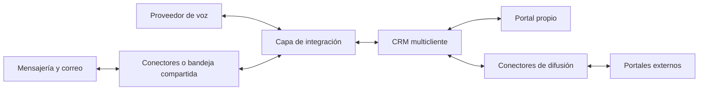

> HISTÓRICO — Diseño v1 sustituido el 9 de octubre de 2026. Consultar el README de la raíz para la arquitectura vigente de ocho CRM independientes y un portal.

# Conexión del CRM con canales y portales

Ampliación del 9 de octubre de 2026. Diseño propuesto; no hay cuentas conectadas ni credenciales configuradas.

El CRM se conecta con cada proveedor mediante una API y recibe avisos de eventos mediante webhooks. Se propone una capa de integración que traduzca esos eventos al mismo modelo comercial. Así, una consulta puede convertirse en contacto, conversación y oportunidad, independientemente del canal de origen.

## Tres capacidades diferentes

Recibir un interesado desde un formulario, conversar con él y publicar contenido son integraciones distintas. Tener acceso a una API de mensajes no habilita automáticamente publicar anuncios, recuperar historiales anteriores o administrar campañas.

| Canal | Mecanismo | Primer uso propuesto | Condición principal |
| --- | --- | --- | --- |
| WhatsApp | Business Platform mediante Cloud API o proveedor autorizado | Recibir y responder consultas, adjuntar fichas y registrar estados | Cuenta y número habilitados, reglas de mensajería y permisos |
| Instagram | API para cuentas profesionales y webhooks | Mensajes directos vinculados al CRM | Autorización del negocio y permisos aprobados para el uso previsto |
| Correo | Gmail API, Microsoft Graph o IMAP y SMTP | Recibir, responder y mantener hilos | Autorización del buzón y configuración del dominio |
| Teléfono | Proveedor de voz o central VoIP con API | Registrar llamadas y permitir iniciar llamadas desde la ficha | Número o central integrable y disponibilidad local |
| TikTok | Lead Generation y, por separado, Business Messaging | Ingresar leads de campañas; mensajería si se obtiene acceso | Cuenta, región y permisos elegibles |
| Telegram | Bot API y webhook | Conversaciones con un bot de la inmobiliaria | Bot autorizado; no implica acceso a chats personales |
| Portal propio | API del CRM | Consultas y catálogo publicado | Validar publicación y tenant desde el servidor |
| Portales inmobiliarios externos | API, feed o mecanismo acordado por proveedor | Publicar inmuebles e ingresar consultas por circuitos separados | Acuerdo y acceso habilitado para cada portal |

Las fuentes y las limitaciones específicas se detallan a continuación.

## WhatsApp

Probar primero con un número de prueba o dedicado. Configurar una cuenta de WhatsApp Business Platform, registrar la aplicación o elegir un proveedor autorizado, habilitar el número, suscribir eventos y probar un mensaje entrante y su respuesta. Para conectar negocios de terceros a escala, preparar el flujo de alta y las revisiones exigidas por Meta o delegarlo en un proveedor que las gestione. [Ejemplo documentado de alta integrada en Chatwoot](https://developers.chatwoot.com/self-hosted/configuration/features/integrations/whatsapp-embedded-signup).

Antes de usar el número actual, comprobar si admite el flujo de coexistencia elegido o requiere migración. No prometer conservación automática de toda la historia de chats ni continuidad en la aplicación móvil sin esa prueba.

WhatsApp distingue mensajes de servicio y otras categorías. Una interacción del usuario abre una ventana de atención de 24 horas; fuera de ella, la reanudación mediante plantillas debe ajustarse a las reglas del canal. El precio depende de categoría y mercado, con supuestos de gratuidad específicos. Presupuestar además el proveedor si se utiliza. [Precios y ventana de atención](https://business.whatsapp.com/products/platform-pricing) y [plantillas en la bandeja](https://app.chatwoot.com/hc/user-guide/articles/1677492191-adding-inboxes).

Usar la integración oficial como base productiva. Un enlace de WhatsApp facilita iniciar contacto, pero por sí solo no registra en el CRM los mensajes posteriores.

## Instagram

Conectar la cuenta profesional mediante el flujo autorizado de Meta, configurar eventos y solicitar los permisos correspondientes. La guía de Chatwoot documenta un flujo con Instagram Business Login. [Configuración](https://developers.chatwoot.com/self-hosted/configuration/features/integrations/instagram-via-instagram-business-login).

Probar por separado mensajes, adjuntos y cualquier evento adicional que se quiera usar. La gestión de comentarios, la recepción de leads publicitarios y la publicación de contenido requieren validar capacidades y permisos propios; no se incluyen por el solo hecho de conectar mensajes directos. No prometer acceso a todo el historial anterior.

## Correo electrónico

Gmail puede notificar cambios de buzón mediante Cloud Pub/Sub; el conector recupera los cambios y renueva la suscripción. Outlook dispone de notificaciones mediante Microsoft Graph. El flujo de autorización debe solicitar solo los permisos necesarios y contemplar renovación y revocación. [Gmail](https://developers.google.com/workspace/gmail/api/guides/push) · [Microsoft Graph](https://learn.microsoft.com/en-us/graph/outlook-change-notifications-overview).

Para correo de Hostinger, revisar el producto contratado y usar sus parámetros IMAP para recepción y SMTP para envío. Hostinger documenta soporte de esos protocolos. [Soporte de correo](https://www.hostinger.com/support/1583644-does-hostinger-support-pop3-imap-and-smtp/).

El diseño debe conservar identificadores de mensaje y referencias del hilo, evitar importar dos veces el mismo correo y comprobar la configuración de autenticación del dominio. SMTP permite enviar; no sincroniza por sí solo la bandeja de entrada. Para el piloto, conectar un buzón comercial compartido por inmobiliaria y acordar qué carpetas o etiquetas se procesan.

## Teléfono

Para registrar eventos automáticamente, las llamadas deben atravesar un proveedor o una central que pueda avisar al CRM. Twilio es un ejemplo con webhooks de llamadas, estados y grabaciones. [Documentación de voz](https://www.twilio.com/docs/usage/webhooks/voice-webhooks).

Validar numeración disponible en Argentina, portabilidad o desvío, tarifas y operación de la línea actual antes de elegir proveedor. Un botón con un enlace telefónico puede iniciar una llamada, pero no informa automáticamente si fue atendida ni cuánto duró. Las llamadas de una línea celular común no aparecen en el CRM por el solo hecho de guardar ese número.

Propuesta inicial: guardar dirección entrante o saliente, identificador de llamada, agente, inicio, duración y resultado. Grabación y transcripción son funciones adicionales, desactivadas inicialmente hasta definir autorización, acceso y retención. Las llamadas de WhatsApp también constituyen una capacidad distinta de la mensajería y no se asumen cubiertas por la integración de texto.

## TikTok

Empezar por los leads de formularios o campañas y conservar campaña, formulario y anuncio cuando estén disponibles. TikTok documenta conexiones para exportar leads al CRM. [Integración de leads](https://ads.tiktok.com/help/article/about-one-click-crm-integration?lang=en).

Para mensajes directos, existe Business Messaging. La guía actual de Chatwoot exige cuenta de negocio en una región elegible y aprobación específica de acceso. Debe verificarse la cuenta argentina concreta; la existencia del conector no garantiza su habilitación. [Conector de mensajería](https://developers.chatwoot.com/self-hosted/configuration/features/integrations/tiktok).

Publicar videos es un proyecto diferente de ingresar consultas. Como alternativa inicial, dirigir visitantes hacia una ficha del portal o un canal ya conectado, conservando la atribución de campaña cuando sea posible.

## Telegram

Crear un bot por inmobiliaria, proteger su token y registrar un webhook HTTPS con validación del secreto. Asociar los chats y mensajes recibidos a la conexión autorizada. [Telegram Bot API](https://core.telegram.org/bots/api).

El alcance del piloto son conversaciones con el bot, no la lectura de la cuenta personal de un agente. La identidad Telegram se guarda como identificador del canal; no se asume que revela un teléfono ni que corresponde a un contacto existente por tener un nombre parecido.

## Portales inmobiliarios

Tratar cada portal como un conector independiente con dos contratos: salida de publicaciones y entrada de consultas. Mercado Libre documenta una API de publicación de inmuebles; el detalle debe contrastarse al implementar porque sus campos y requisitos cambian. [Documentación de inmuebles](https://developers.mercadolibre.com.ar/es_ar/publica-inmuebles/publica-inmueble).

Para Zonaprop, Argenprop u otros, solicitar al proveedor sus condiciones de integración, acceso y pruebas. No asumir una API pública o que un acuerdo disponible para Tokko se transfiere a este proyecto. Sin acceso, contemplar exportaciones admitidas o carga manual. Los correos de consultas pueden ser una entrada provisional si el contrato lo permite y se validan sus formatos; no sustituyen la sincronización completa del portal.

Guardar el identificador externo de cada publicación, su estado, último envío y errores. Probar altas, modificaciones, rechazo, baja y conciliación. Un inmueble retirado localmente puede seguir visible remotamente hasta confirmar la baja.

## Arquitectura común propuesta

El CRM conserva propiedades, contactos comerciales, oportunidades y tareas. Cada conector traduce los eventos del proveedor a registros comunes. Un webhook es un aviso de que ocurrió algo; puede repetirse, llegar tarde o requerir una consulta posterior a la API.

Flujo propuesto: verificar autenticidad → resolver conexión e inmobiliaria → guardar evento durable → confirmar recepción → procesar → enlazar conversación y contacto → asignar responsable. La respuesta sale por una bandeja de trabajos y su estado se actualiza con el identificador del proveedor. Los callbacks de control de llamadas pueden requerir respuesta inmediata y no deben tratarse como un trabajo diferido normal.

Modelo adicional al CRM: `channel_connections`, `channel_identities`, `conversations`, `messages`, `integration_events`, `calls` y `external_publications`. Registrar tenant, conexión, IDs del proveedor, dirección, fecha de origen, estado y atribución disponible. No crear una oportunidad nueva por cada mensaje.

## Separación entre inmobiliarias

Cada número, cuenta social, buzón, bot y cuenta de portal pertenece a una conexión autorizada de una inmobiliaria. El backend determina el tenant a partir del recurso del proveedor después de verificar el evento; no acepta un tenant arbitrario enviado por el cliente.

Las credenciales se cifran y se usan solo desde el servidor. Se deben probar revocación, reconexión, tokens vencidos, reintentos y cuotas por organización. Evitar mensajes o credenciales completos en registros de diagnóstico.

Una misma persona puede contactar por Instagram y WhatsApp sin que exista una identidad común verificable. Proponer enlaces de contactos al agente o pedir una confirmación adecuada; no fusionar solo por nombre. No compartir contactos entre inmobiliarias.

## Construir conectores o incorporar Chatwoot

Para pocos canales, los conectores directos conservan una infraestructura más simple. Para una bandeja completa con agentes, asignación y múltiples canales, se propone evaluar Chatwoot antes de construir toda esa interfaz. Chatwoot documenta canales como WhatsApp, Instagram, correo y Telegram. [Canales](https://www.chatwoot.com/features/channels).

En la variante con Chatwoot, mantenerlo como dueño del historial de mensajes y al CRM como dueño del proceso comercial. Conectar ambos por API y webhooks, conservar IDs cruzados y designar un único emisor por cuenta para evitar respuestas duplicadas. Probar una cuenta Chatwoot por tenant, con buzones y agentes separados; validar el aislamiento antes de compartir una instancia.

La edición comunitaria utiliza MIT para el código cubierto por esa licencia; el directorio Enterprise tiene condiciones diferentes. Revisar la edición y versión escogidas, incluyendo canales, autenticación y permisos necesarios. [Licencia](https://github.com/chatwoot/chatwoot/blob/develop/LICENSE).

Chatwoot agrega Ruby/Rails, PostgreSQL, Redis y procesos de trabajos. Su despliegue autoalojado no cabe como una simple aplicación Node.js. Usar VPS o un servicio administrado para Chatwoot; CRM y portal pueden conservar su alojamiento independiente. Recalcular recursos, mantenimiento y presupuesto en esta variante. [Requisitos](https://developers.chatwoot.com/self-hosted/deployment/requirements).

La bandeja puede empezar como aplicación enlazada desde el CRM. Mostrarla dentro de una interfaz única exige trabajo adicional de autenticación, navegación y permisos; no se obtiene solo instalándola. Chatwoot tampoco sustituye los conectores de publicación inmobiliaria.

## Orden de implementación

1. Elegir una inmobiliaria piloto e inventariar sus cuentas, titulares, permisos y volumen. Confirmar que el CRM tendrá API o mecanismo de extensión si finalmente se elige un producto existente.
2. Probar el formulario del portal y un buzón comercial: consulta, respuesta, hilo y asignación.
3. Conectar WhatsApp e Instagram; tramitar las aprobaciones en paralelo al desarrollo.
4. Probar Telegram como ejercicio técnico de webhook y aislamiento.
5. Incorporar la telefonía que ya utiliza la inmobiliaria y un primer portal autorizado según valor comercial.
6. Agregar TikTok leads y mensajería cuando la cuenta tenga acceso; ampliar después a más canales.

Este orden es una propuesta, ajustable por volumen real de consultas. La estimación original de 12–16 semanas correspondía al MVP acotado; no incluye automáticamente esta expansión omnicanal. Reestimar al elegir canales, permisos, telefonía y variante con o sin Chatwoot.

## Demostración para el laboratorio

Enviar una consulta ficticia por un canal conectado, verla en la bandeja, vincularla a una propiedad y asignar una visita. Repetir el mismo evento y comprobar que no duplica el mensaje. Intentar leerlo desde otra inmobiliaria y verificar el rechazo. Interrumpir temporalmente el envío y mostrar el reintento registrado.

Antes de declarar operativo un canal, verificar entrada, salida, adjuntos necesarios, estados, atribución disponible, desconexión, permisos, costo y recuperación. No se ha ejecutado todavía esta demostración.

## Alcance de la investigación

Se consultaron las fuentes enlazadas el 9 de octubre de 2026. Las páginas directas de Meta devolvieron limitación de acceso al navegador de investigación; se contrastaron su página comercial de WhatsApp y las guías oficiales de integración de Chatwoot. Los nombres exactos de permisos y versiones API deberán fijarse desde el panel de la aplicación elegida. No se verificaron cuentas reales ni acceso comercial a portales.
